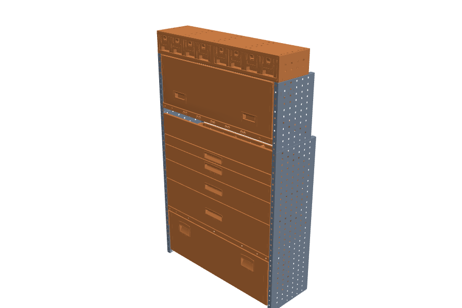

# Collaudo del passaggio alla produzione

5 novembre 2026. Esito delle fasi 7 e 8 di
[task-passaggio-produzione.md](task-passaggio-produzione.md): cosa è stato
provato, con quale test, e cosa resta al cliente.

## Veicolo (T38–T41)

| Verifica | Esito | Dove |
| --- | --- | --- |
| Ancoraggi `anchor_<NOME>` letti al centro della geometria del cubetto; un Empty vale per la sua posizione | ok | `src/lib/io/anchors.ts`, test «vehicle anchors are the centres of their marker cubes» |
| Manifest dei veicoli: vano, pianale, scala, ancoraggi, porte; ciò che il GLB non porta sta in una correzione legata al file | ok | `catalog/manifest.json` → `enclosures`, `enclosureFor` |
| IVECO Daily L2H3: origine al centro del pianale (Y da 0 a 2.097 m, X ±0.905, Z −1.600…1.597), in metri; nessun `Body_interior` né `anchor_*` nel GLB → vano 1.81 × 2.097 × 3.197 m e ancoraggi `pavimento-dx/sx` nel manifest | ok, dati da confermare | rapporto del catalogo |
| FIAT NDC 40H2: esportato a 0.1×, ancoraggi 20 cm sopra il pianale → scala 10, pianale e ancoraggi nel manifest | ok, dati da confermare | rapporto del catalogo |
| Parete nel vano: composta a mano, spostata nell'angolo posteriore destro, nessun errore di validazione né fuori vano | ok | test «the quoted wall composes by hand, matches the reference and validates inside the van» |

**Porte (T41)** — decisione del 6 novembre 2026 (Andrea Termini): **porte
mobili escluse dalla prima consegna**. I GLB attuali dei furgoni non hanno
porte come nodi separati; il formato è già pronto
(`EnclosureDefinition.doors`, rotazione o scorrimento per nome di nodo,
pulsante «Apri» della libreria). Quando serviranno, il cliente esporta le porte come nodi con nome stabile e
indica perni, assi e corse; noi li scriviamo nel manifest del veicolo e
proviamo l'apertura.

## Collaudo della parete (T42)

`tests/tasca-wall.test.mjs` ricostruisce la parete del preventivo 99003819
**da una scena vuota con i comandi dell'interfaccia** (aggiunta dal catalogo,
rotazione, trascinamento, coppia specchiata, «Aggancia nella scena» con punto
iniziale, destinatario e punto finale), con il catalogo costruito da GLB e
manifest, e la confronta con il riferimento di
`tests/fixtures/tasca-99003819`:

| Confronto | Esito |
| --- | --- |
| 14 pezzi: posizione | entro 0.2 mm (la demo arrotondava i valori CAD a 0.1 mm) |
| orientamento, specchiatura | identici |
| 22 collegamenti (stessi punti, stessi pezzi) | identici |
| distinta | identica |
| validazione nel vano IVECO | nessun errore |

Immagini del risultato: la parete ricostruita
([vista](montaggio/parete-99003819-vista.png), sezioni ai fori
[anteriori](montaggio/parete-99003819-sezione-front.png) e
[posteriori](montaggio/parete-99003819-sezione-back.png), `npm run
catalog:images -- --project tests/fixtures/tasca-99003819/reference-project.json
--name parete-99003819`), gli assiemi campione in [montaggio/](montaggio/), le
viste isometriche e il PNG prodotti dal test di export.

L'applicazione di prova compone dall'interfaccia, nel browser, fianchi, coppia
e cassetto e li salva e riapre (`tests/e2e/app.spec.ts`).

## Errori e aggiornamenti (T43)

| Caso | Comportamento | Test |
| --- | --- | --- |
| GLB mancante | manifest senza GLB: prodotto escluso e segnalato (`asset-missing`); file 404 a runtime: errore del modello sul solo pezzo | `catalog.test.mjs`, `tests/e2e/integration.spec.ts` (modello rotto) |
| Marker duplicato | errore bloccante con file, punto e intervento, anche se il caricatore rinomina il secondo in `_1` | `catalog.test.mjs` |
| Manifest incompatibile | manifest che non rispetta lo schema: errore bloccante con il percorso del campo; GLB senza manifest: `manifest-missing` | `catalog.test.mjs` |
| Revisione mancante | il progetto non si apre in silenzio: messaggio e scelta esplicita «Apri con la revisione corrente»; puntatore incoerente rifiutato | `catalog.test.mjs`, `tests/e2e/app.spec.ts` |
| Aggiornamento di un prodotto | nuova revisione; correzioni del vecchio file non applicate e segnalate; un GLB riesportato con gli stessi marker lascia valido il progetto salvato; rollback rifiutato se un file della revisione è cambiato | `catalog.test.mjs` |

## Prestazioni (T44)

Misure su questa macchina (MacBook, Node 25) e in Chromium con WebGL
**software** (SwiftShader, come in CI): sono un limite superiore per un
dispositivo con GPU.

| Misura | Valore | Soglia del test |
| --- | --- | --- |
| Controllo del catalogo completo (19 GLB, 2 veicoli, 6 assiemi) in Node | ≈ 0.5 s | — |
| Avvio dell'applicazione fino al catalogo pronto | 0.8–1.5 s | 10 s |
| Apertura della parete (14 pezzi, 12 GLB) fino a «Configurazione valida» | 0.5–0.7 s (server locale) | 60 s |
| Frame durante l'orbita sulla parete completa: mediana | ≈ 17 ms | 250 ms |
| Frame: 95° percentile | picchi di alcuni secondi al primo disegno (compilazione shader in software) | — |

Soglie concordate il 6 novembre 2026 (Andrea Termini) per desktop e portatili
aziendali con il catalogo attuale (circa 20 prodotti):

| Misura | Soglia |
| --- | --- |
| Catalogo pronto | < 2 s su rete aziendale |
| Primo modello visibile dopo «Aggiungi» | < 1 s per GLB fino a 1.5 MB |
| Parete del preventivo aperta e valida | < 5 s |
| Fluidità durante il trascinamento | mediana < 20 ms (50 fps), nessun frame > 100 ms dopo il caricamento |

I cassetti KDW (226–266 mila triangoli) e la cassettiera KDU (328 mila)
superano la soglia di 200 000 triangoli del controllo: sono segnalati come
modelli pesanti, da semplificare all'esportazione.

## Export (T45)

`tests/e2e/production.spec.ts` apre la parete nell'applicazione ed esporta:

| Export | Verifica |
| --- | --- |
| Distinta PDF | tutti i codici della distinta di riferimento presenti |
| PNG | immagine valida, non vuota |
| GLB | un nodo per ciascuno dei 14 pezzi |
| Viste isometriche PDF | documento valido con le tavole |

La distinta è calcolata dal progetto (`buildProjectBom`) ed è uguale a quella
di riferimento dopo composizione, riapertura, eliminazione e annulla.

## Rimozione della demo (T46)

- `src/tascaWall.ts` spostato in `tests/fixtures/tasca-99003819/legacyDemo.ts`,
  usato solo dai test come riferimento.
- `src/App.tsx` senza catalogo, veicoli o progetti scritti a mano; tolti i
  pulsanti «Parete preventivo 99003819» e «Registra demo KIT» e la dipendenza
  `html2canvas`.
- Tolti `public/catalog/assembly-manifest.json` (sostituito da
  `catalog/manifest.json` e dalle revisioni pubblicate), le anteprime fatte a
  mano e `scripts/catalog-previews.html`.
- `tests/production-path.test.mjs` fallisce se sotto `src/` compare un id o un
  codice di prodotto o veicolo, o un import dalle fixture, e verifica che la
  revisione pubblicata corrisponda a GLB e manifest attuali.

## Verifiche finali (T47)

Eseguite il 5 novembre 2026 dopo la rimozione della demo, tutte con esito
positivo:

| Comando | Esito |
| --- | --- |
| `npm run lint` | nessun problema |
| `npm test` | 152 test Vitest in 9 file (soglie di copertura rispettate), bundle 67.1 kB gzip (budget 72), verifiche sui GLB reali 6 + 35 + 14 + 43 |
| `npm run build:lib` | ok |
| `npm run build:demo` | ok |
| `npm run test:e2e` | 9 test: pagina di integrazione (6) e applicazione di prova (composizione manuale, salvataggio, riapertura, revisione mancante, export, tempi) |

## Aperto, a carico del cliente

- Conferma delle regole meccaniche ([dettagli-montaggio.md](dettagli-montaggio.md)):
  tutti i prodotti hanno `review.confirmed: false`.
- Codici della viteria per la distinta.
- Prima esportazione CAD con marker `SNAP_<TIPO>__<NOME>` centrati e veicoli
  con `Body_interior` e `anchor_<NOME>`.
- Il backend di produzione: l'API è specificata e implementata come file
  statici di riferimento; la conservazione dei GLB per revisione è del backend.
