# Dettagli di montaggio della parete 1014 — da confermare con il cliente

Immagini generate dai GLB reali (`npm run catalog:images`) sugli assiemi
campione del manifest, composti con la stessa matematica dell'editor. Le
sezioni sono tagli orizzontali 4 mm sopra il foro usato, visti dall'alto:
grigio il fianco, arancio il pezzo appeso. Il fronte del fianco è in basso
(colonna anteriore) o in alto (colonna posteriore).

Ogni riga «Da confermare» è una regola meccanica che oggi deduciamo dai GLB e
dal preventivo: finché il cliente non la conferma, il prodotto resta con
`review.confirmed: false` e il rapporto del catalogo la elenca.

## Regola comune: le staffe dietro la lamiera

Il fianco YSI è un profilo a C con lamiere anteriore e posteriore da 1.5 mm,
forate ogni 36 mm con l'asse dei fori a 17 mm dalla faccia esterna. I fori
sono generati dal manifest sulla faccia **interna** della lamiera; ogni pezzo
appeso porta il punto di contatto sulla faccia della propria staffa, quindi le
staffe restano dietro la lamiera. Il controllo del catalogo verifica su ogni
assieme campione che nessuna parte del pezzo che entra nel profilo superi la
faccia interna (tolleranza 0.1 mm).

**Da confermare**: spessore 1.5 mm, passo 36 mm, asse a 17 mm, primo foro a
18 mm dalla base, numero di fori ricavato dall'altezza (30 sul YSI 03036, 11
sul YSI 01131); stessi valori per la colonna posteriore.

## Fianchi con cassetto KDW 40236

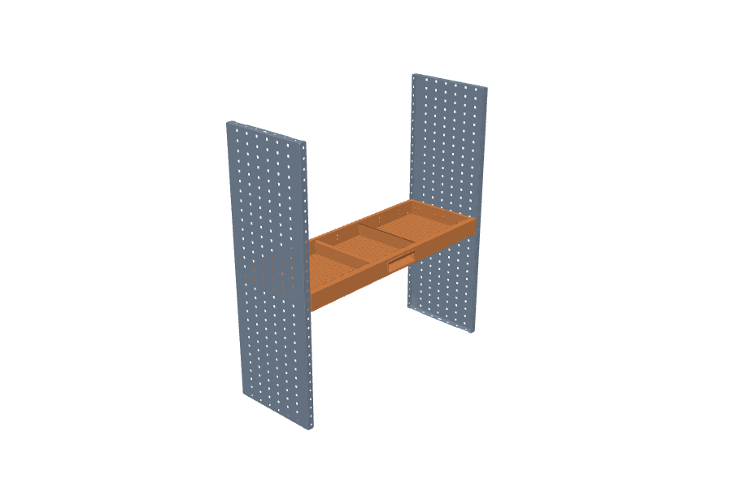

L'inserto filettato del cassetto (`ADF_IFERM8`) è la parte più avanzata dentro
il profilo: appoggia alla faccia interna della lamiera; la guida è 0.7 mm più
indietro. **Da confermare**: è l'inserto (e non la guida) che appoggia sulla
lamiera; campata ammessa solo 1014 mm; il cassetto occupa i fori verso l'alto
a partire da quello scelto.

## Fianchi con antina inferiore KLD 41000

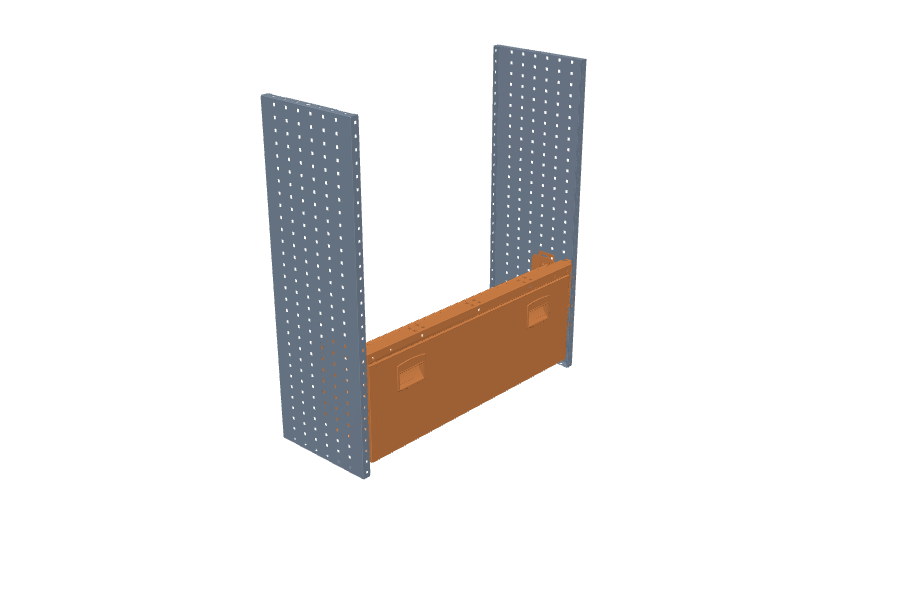
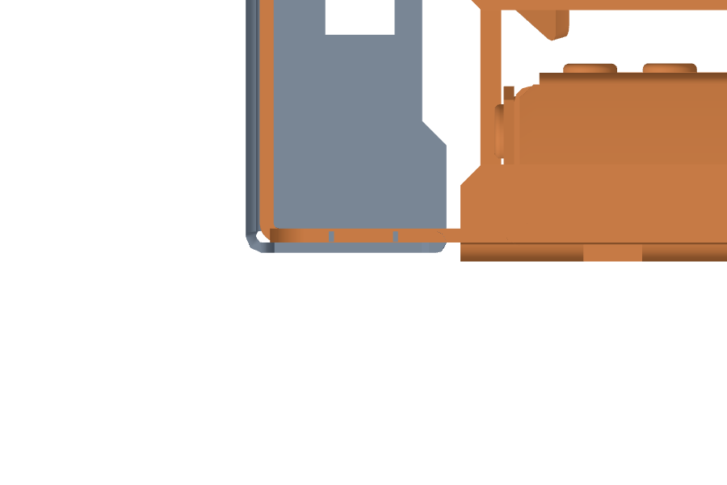

Le staffe `ZLC00900` e le piastre `ABC00001` entrano nel profilo e appoggiano
alla lamiera. **Da confermare**: il foro di riferimento è quello superiore
della staffa; l'antina inferiore lascia libero un passo sopra il pianale nel
preventivo.

## Fianchi con ripiano KCP 40531

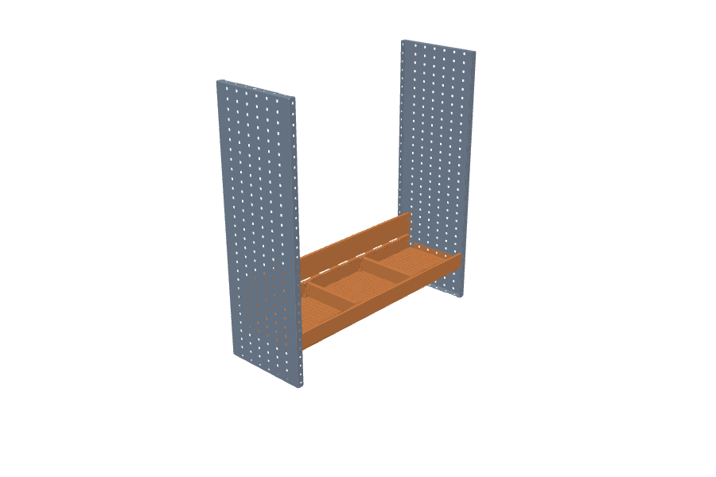

## Angolari KMA 40100 sui fori anteriori e posteriori

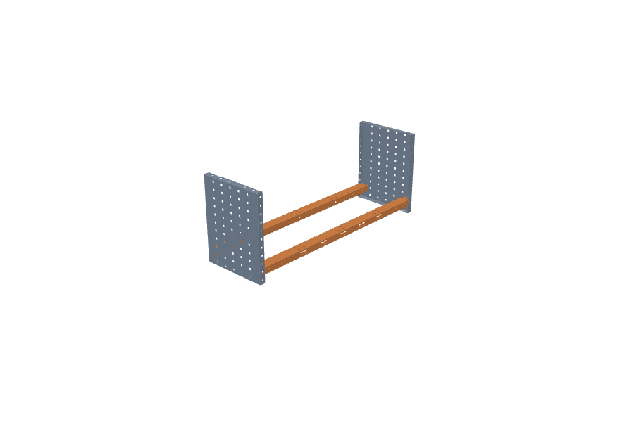
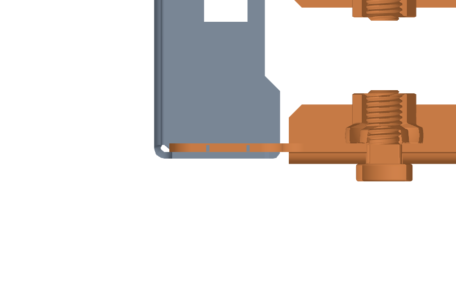
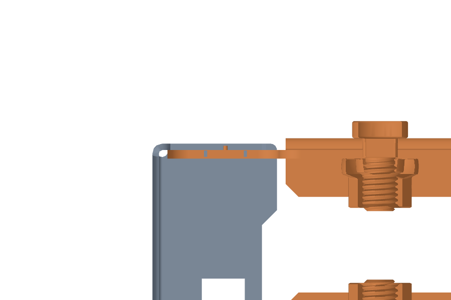

L'angolare anteriore usa l'estremità sinistra sul fianco esterno; quello
posteriore, ruotato verso la parete, l'estremità destra sulla colonna
posteriore. **Da confermare**: l'angolare posteriore si monta sulla colonna
posteriore alla stessa altezza dell'anteriore.

## Angolare leggero XLA 40400

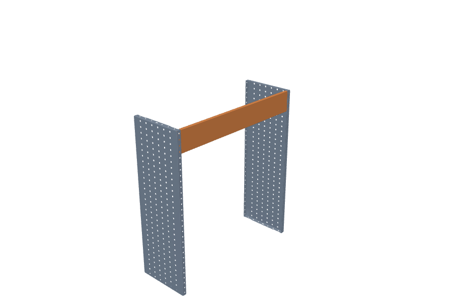
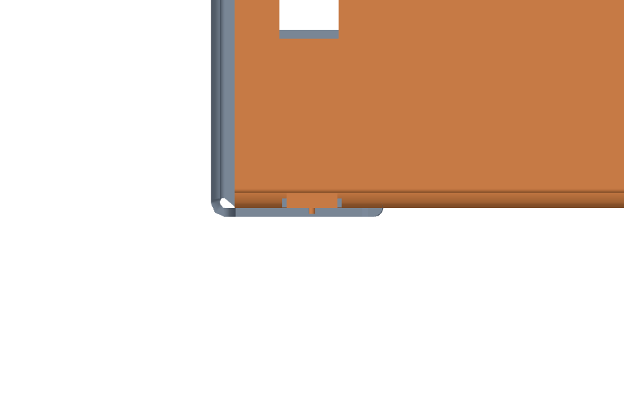

Modellato in lunghezza su Z con la faccia verso +X: la faccia resta verso il
corridoio se l'estremità sinistra va sul fianco esterno.

## Sovrapposizione dei fianchi, antina superiore e cassettiera

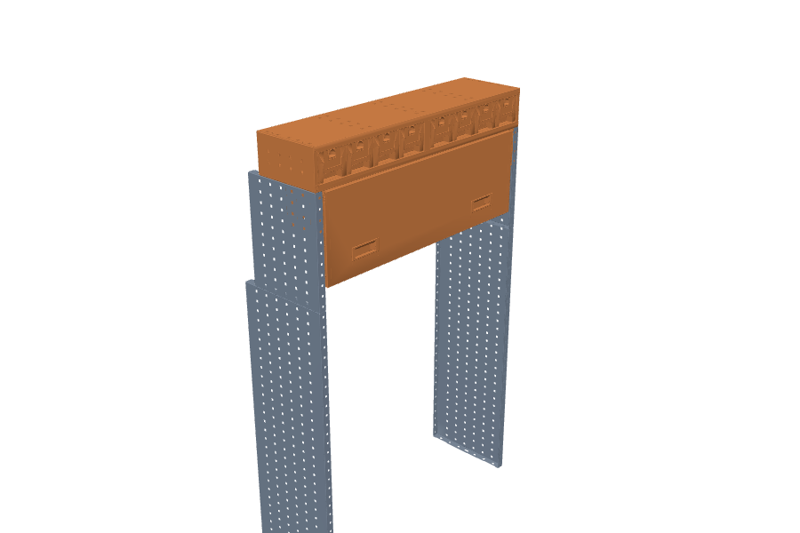
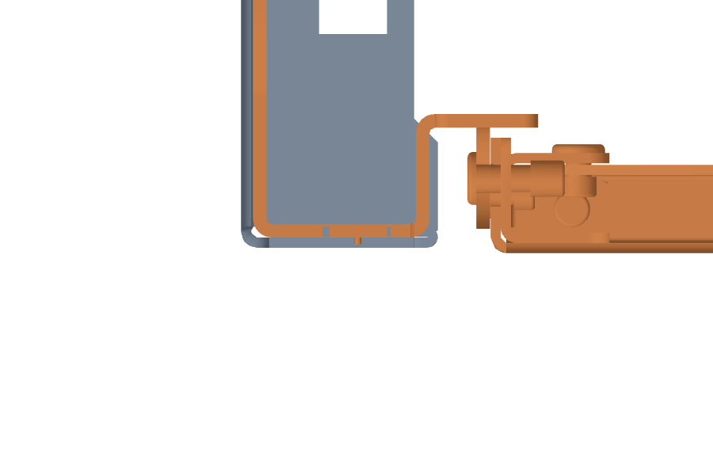

Il YSI 01131 si appoggia sul YSI 03036 con i fronti allineati; la cassettiera
KDU 40426 appoggia sulla testa dei fianchi superiori. **Da confermare**:
allineamento dei fronti nella sovrapposizione; la cassettiera appoggia (non si
avvita ai fori).

## Coppie specchiate

La coppia è definita dalla regola `RULE_MIRRORPAIR_D254.507.761.1014.1268.1521`
del GLB (distanze ammesse in mm) e dall'asse del manifest (verso il gemello,
−Z del GLB). I pezzi della serie 1014 dichiarano `bays: [1.014]`: su una coppia
a un'altra distanza l'aggancio è rifiutato con «Campata non ammessa».
**Da confermare**: le sei distanze della regola sono tutte campate reali; quali
pezzi esistono per le campate diverse da 1014.
