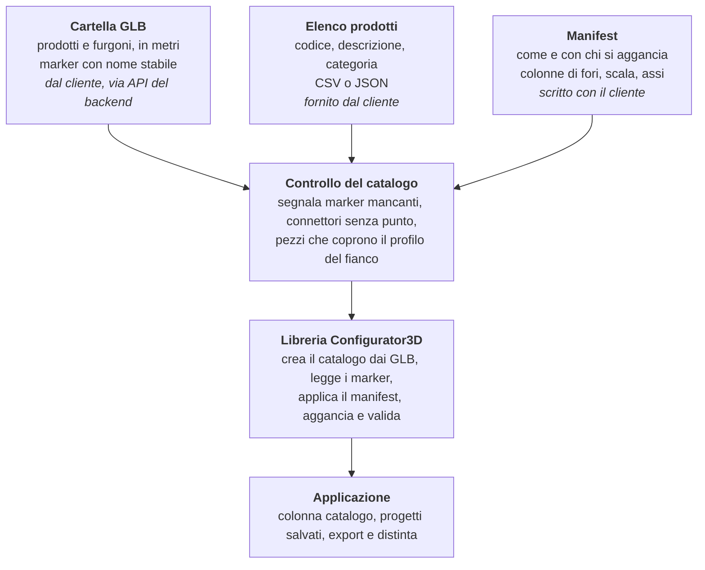

# Configuratore 3D — piano di passaggio dalla demo alla produzione

5 novembre 2026 · Andrea Termini

> Stato: piano attuato. Le tabelle «Situazione attuale» descrivono la demo prima del passaggio; l'esito è in [task-passaggio-produzione.md](task-passaggio-produzione.md) e [collaudo-produzione.md](collaudo-produzione.md).

## Sintesi

La libreria `Configurator3D` è già il motore di un configuratore di produzione; la conoscenza sui prodotti, invece, oggi vive nel codice della demo. Per andare in produzione servono due cose:

- **Da parte nostra:** spostare quella conoscenza in regole generiche lette dalla libreria, scritte nei manifest che prepariamo insieme al cliente, e caricare il catalogo direttamente dalla cartella dei GLB, servita da un'API del backend.
- **Dal cliente:** GLB che rispettano poche regole fisse (unità, nomi stabili dei marker, marker sulla superficie di contatto, un marker per ogni altezza di lavoro dei montanti, furgoni con vano e ancoraggi, codici e categorie).

Il caso delle antine che coprono il profilo del fianco mostra il rischio: la correzione fatta oggi vale solo nella demo e non nel configuratore che userà i GLB del cliente.

## Situazione attuale

Il motore è pronto; dati dei prodotti, veicoli e interfaccia attorno al configuratore sono scritti a mano nella demo (`src/App.tsx`, `src/tascaWall.ts`).

**Già nella libreria (`src/lib`), pronto per la produzione:** rendering, trascinamento, aggancio tra pezzi, coppia specchiata, ancoraggi del vano, lettura dei marker `SNAP_*` / `RULE_*` dai GLB, rilevazione automatica dei fori, validazione dal manifest, ispettore, viste, undo/redo, scorciatoie, modalità camminata, export PNG/GLB/PDF, viste isometriche, distinta. Il componente riceve catalogo, manifest e vano come dati.

**Solo nella demo, da portare in produzione:**

| Cosa | Dove oggi | Perché serve |
| --- | --- | --- |
| Colonne di fori dei fianchi YSI (passo 36 mm, 17 mm dentro la faccia) | `tascaWall.ts`, generate dal codice | il GLB del fianco YSI 03036 ha un solo marker `SNAP_FRONTALE`: senza, i pezzi non si appendono a nessuna altezza |
| Punti di aggancio di cassetti, antine, angolari, ripiano, con l'arretramento di 1.5 mm | `tascaWall.ts` | i marker CAD mettono le staffe sulla faccia del fianco |
| Asse della coppia specchiata dei fianchi | `tascaWall.ts` | il CAD nomina la regola ma non la orienta |
| Altezze del montante YSI 12836 (corrette di 1.3 mm), normali verso l'interno | `App.tsx` | marker mancanti o sbagliati nel GLB |
| Punti di XDS 40236 e XHA 40100 dichiarati a mano | `App.tsx` | l'estrattore numera i marker in ordine di lettura: una riesportazione li rinumera e rompe manifest e progetti salvati |
| Manifest (connettori, compatibilità, collider, distinta) | `public/catalog/assembly-manifest.json` | regole di aggancio dei prodotti |
| Veicoli FIAT e IVECO: scala ×10, pavimento, ancoraggi | `App.tsx`, `tascaWall.ts` | i GLB dei furgoni non li hanno giusti |
| Colonna catalogo, ricerca, filtro «compatibili», elenco della scena, apertura e download JSON | `App.tsx` | interfaccia attorno al configuratore |
| Anteprime dei prodotti | `public/catalog/previews`, generate a mano | immagini nella colonna catalogo |
| Parete composta dal preventivo 99003819 | `buildTascaWall` in `tascaWall.ts` | scritta per quel solo preventivo |

Da eliminare: il pulsante «Registra demo KIT» e i dati di progetto di esempio.

## Caso di esempio: le antine sul profilo del fianco

Sulle antine KLD 41000 e KUD 40900 il profilo frontale del fianco era coperto dalle staffe dell'antina, perché i marker CAD le facevano finire sullo stesso piano della faccia del fianco.

- **Come si monta davvero:** il fianco YSI è un profilo a C con una lamiera frontale spessa 1.5 mm, forata ogni 36 mm. Le staffe dei pezzi entrano nel profilo e si avvitano dietro quella lamiera.
- **Cosa succedeva:** il configuratore fa coincidere il marker del foro del fianco (sulla faccia esterna della lamiera) con il marker del pezzo (sulla faccia della staffa). Le due superfici si sovrapponevano e il disegno mostrava la staffa al posto del fianco.
- **Pezzi interessati:** antine, angolare leggero XLA 40400, angolare KMA 40100, ripiano KCP 40531 (tutti tra −0.05 e +0.04 mm dalla faccia), e in piccolo i fissaggi dei cassetti KDW (−0.10 mm).
- **Correzione provvisoria:** nella demo ogni pezzo appeso ai fori arretra di 1.5 mm, e un test sui GLB reali controlla che nessuna parte copra il profilo. Vale solo per il catalogo della demo.
- **Correzione definitiva:** i fori dei fianchi li genera una regola «colonna di fori» nel manifest, già sulla faccia interna della lamiera; il cliente mette i marker dei pezzi appesi sulla faccia della staffa (sezione «Cosa ci serve dal cliente»).

## Architettura di produzione

In produzione il catalogo non si scrive: è la cartella dei GLB del cliente, letta insieme ai manifest che scriviamo con il cliente: lui conosce le regole di ogni prodotto, noi definiamo il formato e lo verifichiamo.

Tutto ciò che oggi è scritto a mano nella demo diventa una regola del manifest o un requisito sui GLB. Il controllo del catalogo gira ogni volta che arrivano GLB nuovi, prima che il configuratore li usi.

## Lavori da fare da parte nostra

Otto lavori, in ordine: i primi tre servono a leggere i GLB del cliente, gli altri a togliere la demo.

1. **Catalogo dalla cartella dei GLB.** L'elenco dei file arriva da un'API del backend. La libreria crea le voci da sola: id dal nome file, etichetta e categoria dall'elenco del cliente, ingombro dal GLB.
2. **Nomi stabili dei marker.** Leggere `SNAP_<TIPO>__<NOME>`, che il cliente fornirà: oggi la libreria ignora il nome e numera i punti nell'ordine in cui li trova.
3. **Ancoraggi dei furgoni da marker.** Usare il centro del cubetto `anchor_<NOME>` invece della posizione del nodo, che nei GLB esportati da SolidWorks non è significativa.
4. **Nuove regole nel manifest.** Oggi il manifest dichiara solo connettori, collider e distinta. Servono:
    - **colonna di fori** sui fianchi: passo 36 mm, asse 17 mm dentro la faccia esterna, colonna anteriore e posteriore, numero di fori ricavato dall'altezza del GLB; ogni foro sulla faccia interna della lamiera (1.5 mm), così i pezzi appesi restano dietro la lamiera;
    - scala del prodotto (oggi sta nel catalogo, che non esisterà più);
    - asse della coppia specchiata;
    - direzione di aggancio quando non è quella della faccia (montante YSI 12836);
    - un manifest dei veicoli (scala, vano, ancoraggi, porte) per ciò che il GLB non porta.
5. **Controllo del catalogo.** Il test di oggi diventa uno strumento da eseguire su cartella e manifest ogni volta che arrivano GLB nuovi. Segnala GLB senza manifest, connettori che non trovano il punto, marker mancanti o con nomi duplicati, marker non sulla superficie di contatto, pezzi che coprono il profilo del fianco.
6. **Anteprime generate dai GLB** al posto delle immagini fatte a mano.
7. **Applicazione di prova, esterna alla libreria.** Colonna catalogo, ricerca, filtro «compatibili» ed elenco della scena restano fuori dalla libreria, in un'applicazione separata che serve a provare il configuratore. La libreria esporta ciò che le serve: per esempio `definitionFor`, usato dal filtro e oggi non pubblico.
8. **Togliere la demo.** Eliminare `tascaWall.ts`, compreso il generatore automatico della parete (la parete si compone a mano nel configuratore), e i dati scritti in `App.tsx`. La parete del preventivo 99003819 resta come caso di prova: cartella, manifest e un progetto composto a mano, su cui gira il controllo.

## Cosa ci serve dal cliente

Sei regole sui GLB, applicabili su ogni prodotto preso da solo, senza assieme, più le regole di aggancio di ogni prodotto da scrivere insieme nel manifest.

### 1. Unità e orientamento

- Tutti i GLB, prodotti e furgoni, in **metri**, scala 1:1, asse Y verso l'alto.
- Prodotti da appendere tra i fianchi: larghezza lungo X, fronte verso +Z.
- Fianchi: profondità lungo X (da dietro, 0, verso il fronte), altezza lungo Y, faccia esterna a Z = 0.

### 2. Nomi dei marker

- Ogni punto di aggancio è un cubetto di circa 1 mm chiamato `SNAP_<TIPO>__<NOME>`, per esempio `SNAP_FRONTALE__FORO_12`.
- `<TIPO>` è la famiglia di aggancio (`FRONTALE`, `POSTERIORE`, `LATERALE`, `TERRA`, `SOVRAPPOSIZIONE`…).
- `<NOME>` è unico nel file e resta uguale a ogni riesportazione dello stesso prodotto.
- Solo lettere, numeri e trattino basso: niente spazi, punti o due punti.
- Se il CAD non permette di dare un nome alle singole istanze dei marker, ce lo segnalano prima di riesportare.

### 3. Posizione dei marker: superficie di contatto

> Il centro del cubetto sta sulla superficie di contatto, cioè la faccia del prodotto che a montaggio fatto tocca l'altro prodotto, al centro del foro di fissaggio.

- **Fianchi forati:** i fori li genera una regola del manifest, già sulla faccia interna della lamiera. Il cliente non mette marker sui fori dei fianchi; gli altri marker del fianco (appoggio a terra, sovrapposizione) seguono la regola generale.
- **Prodotti appesi ai fianchi** (cassetti, antine, angolari, ripiani): il marker va sulla faccia della staffa che appoggia contro la lamiera, al centro del foro della staffa. Non sul frontale, non sulla guida.
- **Prodotti in appoggio** (es. cassettiera sulla testa dei fianchi): sulla faccia di appoggio.
- Il cubetto è centrato sulla superficie (metà dentro, metà fuori) e sta su una faccia, non su uno spigolo o un angolo: da quella faccia ricaviamo la direzione di aggancio.

Così, a montaggio fatto, il marker di un prodotto appeso coincide con il foro che generiamo sul fianco. Rispetto a oggi: antine, angolari e ripiano sono già corretti; i cassetti hanno il marker 1.2 mm davanti alla staffa e vanno corretti.

### 4. Marker completi

- Sui montanti, un marker per ogni altezza di lavoro (ripiani, traverse).
- Sui fianchi i fori non servono: li genera la regola «colonna di fori» del manifest.

### 5. Furgoni

- Modello in metri, origine al centro del pianale, Y verso l'alto.
- Un solido `Body_interior` che delimita il vano di carico utile.
- Un marker per ogni ancoraggio a pavimento chiamato `anchor_<NOME>`, appoggiato sul pianale.
- Porte e parti mobili come nodi separati, con un nome stabile.

### 6. Codici e categorie

- Nome file = codice prodotto (es. `KDW40236.glb`).
- Una sottocartella per categoria (es. `MONTANTI/`, `ORIZZONTALI/`, `ANTINE/`, `ACCESSORI/`).
- Un elenco (CSV o JSON) con codice, descrizione in italiano e categoria di ogni prodotto.

### 7. Regole dei prodotti per il manifest

Il manifest lo scriviamo insieme: noi definiamo il formato e lo verifichiamo con il controllo del catalogo, il cliente fornisce le regole di ogni prodotto.

- **Compatibilità:** per ogni punto di aggancio, con quali prodotti o punti si può agganciare.
- **Capacità:** quanti pezzi può ricevere ogni punto.
- **Tolleranze e compenetrazioni ammesse:** di quanto un pezzo può entrare nell'altro, e le zone in cui è previsto (per esempio la staffa dentro il profilo del fianco).
- **Fianchi:** passo dei fori, distanza dell'asse dalla faccia esterna, colonne presenti (anteriore, posteriore), spessore della lamiera.
- **Coppie specchiate:** distanze ammesse tra i due fianchi (campate) e lato su cui sta il gemello.
- **Direzione di aggancio**, quando non è quella della faccia del marker (per esempio i ripiani che entrano nel montante dall'interno).
- **Distinta:** codice e descrizione del prodotto, e i componenti che ogni aggancio aggiunge (viteria).
- **Furgoni:** quali porte si aprono, come (rotazione o scorrimento) e di quanto.

## Decisioni prese

| Domanda | Decisione |
| --- | --- |
| Chi scrive il manifest? | Noi insieme al cliente: il cliente conosce le regole di ogni prodotto, noi definiamo il formato e lo verifichiamo. |
| Come viene servita la cartella dei GLB? | Un'API del backend fornisce l'elenco dei file. |
| Il CAD del cliente può dare un nome alle singole istanze dei marker (`SNAP_<TIPO>__<NOME>`)? | Sì: i nomi stabili arrivano dal GLB. |
| Chi posiziona i fori dei fianchi rispetto alla lamiera? | I fori dei fianchi li genera una regola del manifest, già sulla faccia interna della lamiera. Il cliente non deve spostare i marker dei fianchi. |
| Un marker per ogni foro dei fianchi, o una regola? | Regola «colonna di fori» nel manifest. |
| L'interfaccia attorno al configuratore diventa un componente della libreria? | No: serve a provare il configuratore e resta esterna. |
| Comporre una parete da un preventivo sarà una funzione del prodotto finale? | Sì, ma manualmente: la compone l'utente nel configuratore, non un generatore automatico. |
